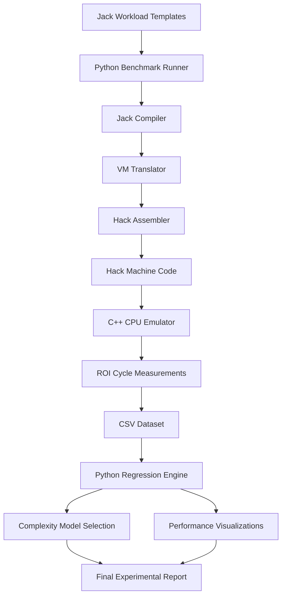
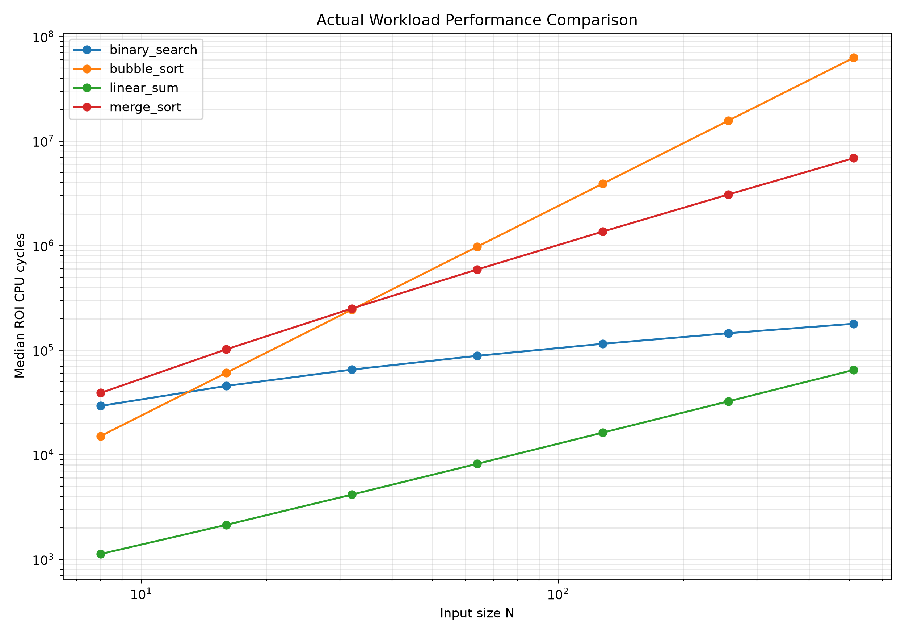
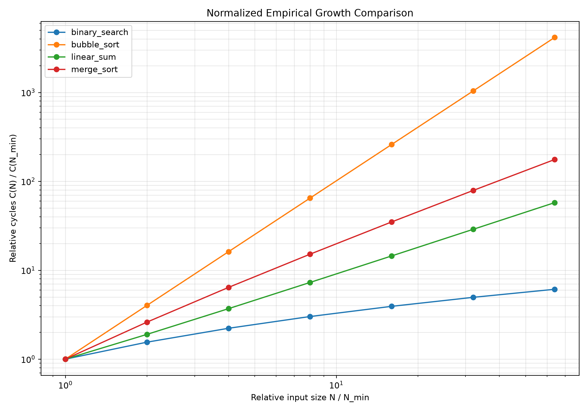

# Algorithmic Execution Profiler

**An experimental framework for measuring algorithm execution costs and estimating asymptotic time complexity using a custom Hack CPU emulator.**

**Course:** CS207  
**Architecture:** 16-bit Hack Computer  
**Implementation:** C++17, Jack, Python  
**Analysis:** NumPy, Matplotlib

---

## 1. Overview

Big-O notation describes how the computational cost of an algorithm grows as its input size increases. While theoretical analysis establishes the asymptotic complexity of an algorithm, this project investigates how that growth manifests experimentally on an actual instruction-execution model.

The Algorithmic Execution Profiler is a benchmarking and analysis framework built around a custom C++ emulator of the 16-bit Hack computer from Nand2Tetris.

Algorithms are implemented in Jack, compiled into VM instructions, translated into Hack assembly, assembled into machine code, and executed by the custom CPU emulator.

The emulator counts the instructions executed inside a designated **Region of Interest (ROI)**, isolating the algorithm from program initialization and other unrelated execution costs.

A Python-based analysis engine processes the resulting measurements, fits multiple mathematical growth models, compares them using statistical criteria, and generates performance visualizations.

The framework currently profiles six workloads spanning logarithmic, linear, linearithmic, quadratic, cubic and exponential growth. The objective is to investigate whether experimentally measured execution costs agree with the theoretical complexity of each algorithm.

## 2. Key Features

- Custom C++ Hack CPU emulator.
- Instruction-level execution and deterministic cycle counting.
- Region-of-interest instrumentation.
- Dedicated memory-mapped emulator control ports.
- Automatic Jack compilation and execution pipeline.
- Automatic discovery of Jack workload templates.
- Six built-in workloads covering $`O(\log N)`$ through $`O(2^N)`$.
- Automated benchmarking across multiple input sizes.
- CSV-based measurement collection.
- Correctness verification for every benchmark.
- Least-squares regression against seven candidate complexity models.
- R-squared, RSS, AIC, AICc and BIC analysis.
- Log-log regression and growth-exponent estimation.
- Normalized-cost analysis.
- Extrapolation-based predictive validation.
- Automatic generation of individual and comparative graphs.

## 3. System Architecture

The complete execution pipeline is:



### 3.1 Execution Pipeline

| Stage | Input | Output | Purpose |
|---|---|---|---|
| Jack workload | Algorithm and input size $`N`$ | `.jack` | Defines the algorithm being measured |
| Jack Compiler | Jack source | `.vm` | Converts Jack into VM instructions |
| VM Translator | VM instructions | `.asm` | Generates Hack assembly |
| Assembler | Hack assembly | `.hack` | Produces 16-bit machine instructions |
| CPU Emulator | Hack machine code | Cycle telemetry | Executes instructions and measures performance |
| Benchmark runner | Workload and input-size configuration | CSV | Automates experiments and stores measurements |
| Regression engine | Benchmark CSV | Statistical results and plots | Identifies plausible empirical growth models |

## 4. Custom CPU Emulator

The core of the project is a custom C++ implementation of the Hack computer's instruction-execution model.

The emulator implements:

- ROM loading for Hack machine-code programs.
- A, D and PC registers.
- A-instruction and C-instruction execution.
- ALU operations and computation controls.
- Destination handling.
- Jump conditions.
- RAM access.
- CPU cycle counting.
- RAM read and write telemetry.
- Region-of-interest instrumentation.
- Memory inspection through command-line arguments.
- Program termination through a dedicated halt port.
- A cycle watchdog to prevent indefinitely executing programs.

### 4.1 Definition of a CPU Cycle

One cycle corresponds to one executed Hack instruction, whether an A-instruction or a C-instruction.

The emulator counts instructions executed inside the ROI separately from the complete program execution.

The measured quantity is therefore:

```math
C(N) = \text{number of Hack instructions executed inside the ROI}
```

These are simulated Hack instruction cycles, not native processor clock cycles or real-world execution time.

### 4.2 Memory Map and Emulator Ports

Three memory-mapped addresses are reserved for emulator instrumentation.

| RAM Address | Purpose |
|---|---|
| `24577` | ROI start |
| `24578` | ROI end |
| `24579` | Emulator halt |

The emulator provides an extended RAM model with the additional control locations.

These ports are emulator-defined and are not part of the standard Hack hardware specification.

### 4.3 Region of Interest

Jack OS initialization and program startup introduce a substantial fixed execution cost. Including this cost in every measurement would distort the performance of small inputs.

To isolate the algorithm, special memory writes mark the beginning and end of the measured region.

In Jack:

```java
var Array port;

let port = 24577;

// ROI START
let port[0] = 1;

// Algorithm being measured

// ROI END
let port[1] = 1;
```

The emulator resets its measurement counters when the ROI start port is written and freezes the measurement when the ROI end port is written.

The measurement is therefore:

```math
C_{\text{ROI}}(N) = \text{number of instructions executed between the ROI markers}
```

The ROI excludes input generation and result verification when these operations are placed outside the markers.

A small fixed amount of marker-related instruction overhead remains and is treated as part of the measured program.

### 4.4 Telemetry

The emulator records:

| Metric | Description |
|---|---|
| CPU cycles | Instructions executed inside ROI |
| RAM reads | Counted RAM operand reads |
| RAM writes | Writes through instruction destinations |
| Whole-run cycles | Total execution count, including startup |
| Selected RAM values | Values inspected after execution |

The emulator prints a comma-separated measurement line:

```text
N,cycles,reads,writes
```

When `--ram-init` is not used, the first field may be zero. The Python benchmark runner records the actual workload input size independently.

The `--peek` command-line option allows the final RAM value to be inspected for correctness.

### 4.5 Termination and Safety

A non-zero write to the halt port terminates the emulator.

The emulator also uses a cycle watchdog to prevent an infinite or incorrectly terminating program from being accepted as a successful benchmark.

An execution that exceeds the watchdog limit is treated as a failed run rather than a valid measurement.

## 5. Workloads

The framework currently supports six algorithmic workloads.

| Algorithm | Expected Time Complexity | Input Characteristics |
|---|---|---|
| Linear summation | $`O(N)`$ | $`N`$ loop iterations |
| Binary search | $`O(\log N)`$ | Sorted array |
| Bubble sort | $`O(N^2)`$ | Reverse-sorted input |
| Merge sort | $`O(N \log N)`$ | Reverse-sorted input |
| Matrix chain multiplication (MCM) | $`O(N^3)`$ | Chain of $`N`$ matrices ($`N+1`$ dimensions) |
| Recursive subset counting | $`O(2^N)`$ | $`N`$ integers and a target sum |

### 5.1 Linear Summation

The linear workload executes a simple loop with $`N`$ iterations.

The measured workload has the form:

```java
while (i < n) {
    let count = count + 1;
    let i = i + 1;
}
```

Each iteration performs a constant amount of work.

Therefore:

```math
T(N) = aN + b
```

and:

```math
T(N) = O(N)
```

### 5.2 Binary Search

Binary search operates on a sorted array.

At every iteration, approximately half of the remaining search interval is discarded.

The recurrence is:

```math
T(N) = T\left(\frac{N}{2}\right) + O(1)
```

Therefore:

```math
T(N) = O(\log N)
```

The benchmark performs successful and unsuccessful searches using a fixed number of repetitions per input size.

The repetition count must remain independent of $`N`$ so that the asymptotic growth is unchanged.

### 5.3 Bubble Sort

Bubble sort is evaluated using reverse-sorted input to exercise its worst-case comparison pattern.

Its number of comparisons is:

```math
(N-1) + (N-2) + \cdots + 1
```

Therefore:

```math
T(N) = \frac{N(N-1)}{2}
```

and:

```math
T(N) = O(N^2)
```

The implementation does not use an early-exit optimization.

### 5.4 Merge Sort

Merge sort recursively divides the array into smaller portions, sorts them, and merges the sorted portions.

Its recurrence is:

```math
T(N) = 2\,T\left(\frac{N}{2}\right) + O(N)
```

Using the Master Theorem:

```math
T(N) = O(N \log N)
```

A temporary array is allocated before the ROI and reused during merging.

### 5.5 Matrix Chain Multiplication (MCM)

Matrix Chain Multiplication finds the minimum number of scalar multiplications needed to compute the product of a chain of $`N`$ matrices. Matrix $`A_i`$ has dimensions $`p_{i-1} \times p_i`$, so the input is a dimension sequence $`p_0, p_1, \ldots, p_N`$ containing $`N+1`$ values.

The workload uses the standard bottom-up dynamic-programming formulation:

```math
m[i][j] =
\begin{cases}
0 & \text{if } i = j \\[4pt]
\displaystyle\min_{i \le k \le j-1} \bigl( m[i][k] + m[k+1][j] + p_{i-1}\,p_k\,p_j \bigr) & \text{if } i < j
\end{cases}
```

Subchains are solved in order of increasing length $`L = 2, 3, \ldots, N`$. For each chain length, every starting index is processed, and every split point inside that chain is evaluated.

The number of split-point evaluations is:

```math
\sum_{L=2}^{N} (N - L + 1)(L - 1) = \frac{N^{3} - N}{6}
```

Each evaluation performs a constant amount of work, so:

```math
T(N) = \Theta(N^{3})
```

and:

```math
T(N) = O(N^3)
```

Implementation notes:

- The cost table is allocated before the ROI, so allocation is not measured.
- The dimension sequence is generated deterministically from $`N`$ outside the ROI.
- Dimension values are kept small so that intermediate costs remain inside the signed 16-bit range.
- The table requires $`O(N^2)`$ words of heap memory, which bounds the usable $`N`$.

### 5.6 Recursive Subset Counting

Recursive subset counting counts the subsets of an array of $`N`$ integers whose elements sum to a target value.

At every position, the recursion considers two possibilities: exclude the current element, or include it and reduce the remaining target.

```math
f(i, r) = f(i+1,\ r) + f(i+1,\ r - a_i)
```

Here $`i`$ is the current position and $`r`$ is the remaining target. The base case is reached when all elements have been considered; it returns $`1`$ if the remaining target is $`0`$, and $`0`$ otherwise.

The implementation uses **no pruning and no memoization**, so the recursion tree always has the same shape for a given $`N`$, independent of the input values. The recurrence for the cost is:

```math
T(N) = 2\,T(N-1) + c
```

which solves to:

```math
T(N) = \bigl(T(0) + c\bigr)\,2^{N} - c
```

This has exactly the form $`a \cdot 2^{N} + b`$ used by the exponential candidate model, so:

```math
T(N) = O(2^N)
```

Implementation notes:

- The input array is generated deterministically outside the ROI.
- Recursion depth equals $`N`$, so stack usage grows only linearly even though the running time is exponential.
- The returned count is at most $`2^N`$ and must fit in the signed 16-bit range, which limits $`N`$.
- Jack function-call overhead gives this workload a large constant factor per recursive call.
- The cycle watchdog also limits the feasible input range.

### 5.7 Correctness Verification

Every workload follows the same verification convention.

The algorithm stores:

- `1` at RAM address `16384` when the result is correct.
- `0` when the result is incorrect.

For the original four workloads, correctness means the output is sorted, the search finds the expected element, or the loop counter equals $`N`$. For MCM, the computed minimum cost is compared against a value known in advance for the generated dimension sequence. For subset counting, the returned count is compared against the value known in advance for the generated input.

The Python benchmark runner checks the indicator after execution.

A measurement is not accepted when correctness verification fails.

This prevents an incorrectly implemented algorithm from producing apparently valid performance curves.

## 6. Automatic Benchmarking System

The benchmarking system is implemented in Python.

Its purpose is to remove repetitive manual work from the experimental process.

Instead of manually changing $`N`$, compiling Jack, translating VM code, assembling machine code and executing the emulator, the benchmark runner automates the complete process.

### 6.1 Automatic Workload Discovery

Every `.template` file inside the workloads directory is discovered automatically.

Example:

```text
analysis/
    workloads/
        linear_sum.template
        bubble_sort.template
        binary_search.template
        merge_sort.template
        matrix_chain.template
        subset_count.template
```

The filename is used as the workload identifier.

The system does not require the user to specify its theoretical complexity.

A new compatible workload can be introduced by adding another Jack template.

### 6.2 Parameterized Workload Generation

Every template contains a replaceable input-size placeholder:

```java
let n = N_VALUE;
```

Before compilation, Python replaces `N_VALUE` with the selected numerical input size.

For example:

```java
let n = 128;
```

The generated source is placed inside a temporary build directory.

The original source templates remain unchanged.

### 6.3 Automated Compilation and Execution

For each workload and input size, the benchmark runner performs:

1. Generate the Jack source.
2. Run the Jack Compiler.
3. Run the VM Translator.
4. Run the Hack Assembler.
5. Execute the generated `.hack` file using the CPU emulator.
6. Extract the ROI cycle count.
7. Read the correctness indicator.
8. Append the measurement to the CSV dataset.

Different workloads use separate temporary build directories to prevent generated files from interfering with one another.

### 6.4 Measurement Storage

Measurements are stored in:

```text
src/analysis/data/benchmarks.csv
```

The dataset includes:

| Column | Meaning |
|---|---|
| `timestamp_utc` | Measurement timestamp |
| `workload` | Workload identifier |
| `N` | Input size |
| `run` | Repetition number |
| `roi_cycles` | Selected ROI cycle count |
| `roi_line` | Original emulator output line |
| `roi_field_0` | First telemetry field |
| `roi_field_1` | Second telemetry field |
| `roi_field_2` | Third telemetry field |
| `roi_field_3` | Fourth telemetry field |
| `whole_cycles` | Complete program execution cycles |
| `ram_16384` | Correctness indicator |
| `correct` | Correctness status |

The precise mapping of ROI fields follows the emulator's output order. The second ROI field is used as the cycle count in the current benchmark configuration.

### 6.5 Experimental Configuration

Input sizes are selected per workload because the usable range depends on both the algorithm and the Hack architecture.

- Linear, binary search, bubble sort and merge sort use geometrically increasing sequences where appropriate.
- Matrix chain multiplication uses moderate sizes, limited by the $`O(N^2)`$ cost table and the 16-bit range of intermediate costs.
- Recursive subset counting uses small, linearly spaced sizes. Geometric spacing is not suitable: doubling $`N`$ squares the cost of an exponential workload, quickly exceeding the cycle watchdog.

Repetitions are used to verify execution consistency. Because the emulator is deterministic for a fixed program and input, repeated executions should produce identical cycle counts.

The median can be used as the representative measurement when repeated observations are available.

## 7. Analysis Methodology

The objective of the analysis is to estimate the empirical time complexity of every workload.

For each workload, the collected data consists of the pairs:

```math
\bigl(N_1, C(N_1)\bigr),\ \bigl(N_2, C(N_2)\bigr),\ \ldots,\ \bigl(N_m, C(N_m)\bigr)
```

where:

- $`N_i`$ is the input size.
- $`C(N_i)`$ is the measured ROI cycle count.
- $`m`$ is the number of distinct input sizes.

### 7.1 Candidate Complexity Models

Seven mathematical growth models are considered.

| Model | Mathematical Form | Expected Complexity | Workload |
|---|---|---|---|
| Constant | $`C(N) = a`$ | $`O(1)`$ | — |
| Logarithmic | $`C(N) = a \ln N + b`$ | $`O(\log N)`$ | Binary search |
| Linear | $`C(N) = aN + b`$ | $`O(N)`$ | Linear summation |
| Linearithmic | $`C(N) = aN \ln N + b`$ | $`O(N \log N)`$ | Merge sort |
| Quadratic | $`C(N) = aN^{2} + bN + c`$ | $`O(N^2)`$ | Bubble sort |
| Cubic | $`C(N) = aN^{3} + bN^{2} + cN + d`$ | $`O(N^3)`$ | Matrix chain multiplication |
| Exponential | $`C(N) = a \cdot 2^{N} + b`$ | $`O(2^N)`$ | Recursive subset counting |

The unknown coefficients $`a, b, c, d`$ are estimated using least-squares regression.

The residual sum of squares is:

```math
\mathrm{RSS} = \sum_{i=1}^{m} \bigl(C(N_i) - \widehat{C}(N_i)\bigr)^{2}
```

where $`\widehat{C}(N_i)`$ is the predicted cycle count.

### 7.2 Goodness of Fit

The coefficient of determination is calculated as:

```math
R^{2} = 1 - \frac{\displaystyle\sum_{i=1}^{m} \bigl(C(N_i) - \widehat{C}(N_i)\bigr)^{2}}{\displaystyle\sum_{i=1}^{m} \bigl(C(N_i) - \overline{C}\bigr)^{2}}
```

where $`\overline{C}`$ is the mean measured cost:

```math
\overline{C} = \frac{1}{m} \sum_{i=1}^{m} C(N_i)
```

A higher R-squared value indicates a closer fit to the measured data.

However, R-squared alone is insufficient because more flexible polynomial models can approximate simpler growth patterns.

### 7.3 AIC, AICc and BIC

Model selection also considers statistical complexity penalties.

The Akaike Information Criterion is:

```math
\mathrm{AIC} = m \ln\left(\frac{\mathrm{RSS}}{m}\right) + 2k
```

The Bayesian Information Criterion is:

```math
\mathrm{BIC} = m \ln\left(\frac{\mathrm{RSS}}{m}\right) + k \ln(m)
```

The corrected AIC is:

```math
\mathrm{AIC}_{c} = \mathrm{AIC} + \frac{2k(k+1)}{m - k - 1}
```

where:

- $`m`$ is the number of observations.
- $`k`$ is the number of estimated parameters, including the residual variance.

Lower values indicate a preferable balance between fitting quality and model complexity.

**Statistical limitation:** Emulator cycle counts are deterministic for identical inputs, so the residuals represent model mismatch rather than ordinary random measurement noise. AIC, AICc and BIC are therefore used as comparative model-ranking diagnostics, not formal probabilities that a complexity class is correct.

**Small-sample caution:** $`\mathrm{AIC}_c`$ requires $`m > k + 1`$. Workloads that can only be measured over a few input sizes (notably the exponential workload) leave little room for four-parameter models such as the cubic, and their $`\mathrm{AIC}_c`$ values should be interpreted with care.

### 7.4 Log-Log Regression

Suppose the execution cost approximately follows:

```math
C(N) = aN^{p}
```

Taking logarithms:

```math
\ln C(N) = \ln a + p \ln N
```

The fitted slope $`p`$ estimates the polynomial growth exponent.

Expected approximate values:

| Complexity | Log-Log Slope |
|---|---:|
| $`O(1)`$ | 0 |
| $`O(\log N)`$ | Approaches 0 |
| $`O(N)`$ | 1 |
| $`O(N \log N)`$ | Approaches 1 |
| $`O(N^2)`$ | 2 |
| $`O(N^3)`$ | 3 |
| $`O(2^N)`$ | Not constant; the local slope keeps increasing with $`N`$ |

Log-log regression cannot reliably distinguish linear and linearithmic growth by itself. For exponential growth the log-log relationship is not a straight line, so a fitted slope is not a meaningful exponent; a steadily increasing local slope is itself evidence of super-polynomial growth. Log-log regression is therefore combined with the other model-selection methods.

### 7.5 Doubling Ratio

A useful experimental diagnostic is:

```math
r(N) = \frac{C(2N)}{C(N)}
```

For cost growing like $`N^{p}`$, this ratio approaches $`2^{p}`$.

Expected approximate behaviour:

| Complexity | Doubling Ratio |
|---|---:|
| $`O(1)`$ | 1 |
| $`O(\log N)`$ | Approaches 1 |
| $`O(N)`$ | 2 |
| $`O(N \log N)`$ | Slightly above 2 |
| $`O(N^2)`$ | 4 |
| $`O(N^3)`$ | 8 |
| $`O(2^N)`$ | $`\approx 2^{N}`$ (grows without bound) |

Fixed overhead and insufficiently large inputs can distort these ratios.

For exponential growth, doubling $`N`$ is not an informative step. The step ratio is used instead:

```math
r_{\text{step}}(N) = \frac{C(N+1)}{C(N)} \longrightarrow 2
```

### 7.6 Normalized Cost

Normalized cost divides measured cycles by a proposed growth function $`f(N)`$:

```math
C_{\text{normalized}}(N) = \frac{C(N)}{f(N)}
```

The normalization functions include:

| Candidate | Normalization |
|---|---|
| Constant | $`C(N)`$ |
| Logarithmic | $`C(N) / \ln N`$ |
| Linear | $`C(N) / N`$ |
| Linearithmic | $`C(N) / (N \ln N)`$ |
| Quadratic | $`C(N) / N^{2}`$ |
| Cubic | $`C(N) / N^{3}`$ |
| Exponential | $`C(N) / 2^{N}`$ |

For a quadratic workload:

```math
C(N) = aN^{2} + bN + c
```

we obtain:

```math
\frac{C(N)}{N^{2}} = a + \frac{b}{N} + \frac{c}{N^{2}}
```

Therefore:

```math
\lim_{N \to \infty} \frac{C(N)}{N^{2}} = a
```

A stable normalized-cost curve provides evidence in favour of the corresponding growth function.

### 7.7 Extrapolation Validation

A model that fits existing observations may perform poorly on larger inputs.

The current validation procedure trains on smaller input sizes and predicts the remaining larger measurements.

Relative prediction error is:

```math
E(N) = \frac{\left\lvert C(N) - \widehat{C}(N) \right\rvert}{C(N)} \times 100
```

Mean Absolute Percentage Error is used to summarize these prediction errors:

```math
\mathrm{MAPE} = \frac{100}{q} \sum_{i=1}^{q} \left\lvert \frac{C(N_i) - \widehat{C}(N_i)}{C(N_i)} \right\rvert
```

where $`q`$ is the number of validation points.

This is an empirical predictive check, not a mathematical proof of asymptotic behaviour.

### 7.8 Final Model Selection

The classification is based on combined evidence from:

1. R-squared and residual fit.
2. AIC, AICc and BIC.
3. Estimated log-log slope.
4. Normalized-cost behaviour.
5. Validation prediction error.
6. Theoretical knowledge of the workload.

When multiple candidate models have similar statistical support, the system should report an inconclusive result rather than force a classification.

## 8. Visualizations

The analysis engine generates individual plots for every workload and a combined comparison plot.

### 8.1 Empirical Workload Comparison



This graph compares the measured ROI CPU cycles of the workloads on common logarithmic axes.

### 8.2 Normalized Workload Comparison



Each workload is normalized by its measured cost at the smallest input size:

```math
G(N) = \frac{C(N)}{C(N_{\min})}
```

This emphasizes relative growth rather than absolute execution cost.

### 8.3 Individual Log-Log Analysis

The individual log-log plots show measured cycle growth and fitted predictions.

| Workload | Visualization |
|---|---|
| Linear summation | [Log-Log Analysis](results/loglog_linear_sum.png) |
| Binary search | [Log-Log Analysis](results/loglog_binary_search.png) |
| Bubble sort | [Log-Log Analysis](results/loglog_bubble_sort.png) |
| Merge sort | [Log-Log Analysis](results/loglog_merge_sort.png) |
| Matrix chain multiplication | [Log-Log Analysis](results/loglog_matrix_chain.png) |
| Recursive subset counting | [Log-Log Analysis](results/loglog_subset_count.png) |

### 8.4 Normalized Cost Analysis

| Workload | Visualization |
|---|---|
| Linear summation | [Normalized Cost](results/normalized_linear_sum.png) |
| Binary search | [Normalized Cost](results/normalized_binary_search.png) |
| Bubble sort | [Normalized Cost](results/normalized_bubble_sort.png) |
| Merge sort | [Normalized Cost](results/normalized_merge_sort.png) |
| Matrix chain multiplication | [Normalized Cost](results/normalized_matrix_chain.png) |
| Recursive subset counting | [Normalized Cost](results/normalized_subset_count.png) |

### 8.5 Additional Diagnostics

The project also generates:

- Actual versus fitted predictions.
- Residual plots.
- Model comparison tables.
- Normalized-cost data.
- Empirical complexity summaries.

All figure paths should correspond to the actual PNG files generated and uploaded to the repository.

## 9. Results and Experimental Interpretation

The experimental results are stored in CSV format.

| File | Contents |
|---|---|
| `src/analysis/data/benchmarks.csv` | Raw benchmark observations |
| `data/summary.csv` | Selected model and empirical classification |
| `data/model_comparison.csv` | Candidate model statistics |
| `data/normalized_cost.csv` | Normalized measurements |
| `data/fitted_predictions.csv` | Actual and predicted cycles |

### 9.1 Theoretical Expectations

| Workload | Theoretical Time Complexity |
|---|---|
| Linear summation | $`O(N)`$ |
| Binary search | $`O(\log N)`$ |
| Bubble sort | $`O(N^2)`$ |
| Merge sort | $`O(N \log N)`$ |
| Matrix chain multiplication | $`O(N^3)`$ |
| Recursive subset counting | $`O(2^N)`$ |

The empirical classification should be compared against these theoretical expectations.

The difference between theoretical and measured behaviour is informative.

For example:

- Merge sort can be slower than bubble sort at small input sizes because of recursive calls and merging overhead.
- Binary search can have a large absolute cycle count because of function-call and repetition overhead.
- Linearithmic and linear growth can be difficult to distinguish over a limited input range.
- Matrix chain multiplication performs only about $`N^{3}/6`$ inner iterations, so over a narrow range of $`N`$ its lower-order terms can make it resemble a quadratic.
- Recursive subset counting can only be measured over a small range of $`N`$, where a cubic polynomial may fit a handful of points well. The step ratio approaching 2 and a stable $`C(N)/2^{N}`$ are the key evidence for exponential growth.
- Fixed overhead can distort measured growth for small inputs.

### 9.2 Correctness and Reproducibility

Each workload is verified using a RAM value after execution.

The benchmarking process checks correctness before accepting a measurement.

The custom emulator is deterministic for the same binary program and initial state. Repeated executions are used to check this property and the stability of the build-and-run pipeline.

**Final numerical conclusions should be taken from the committed `summary.csv` and `model_comparison.csv`, not from illustrative examples or theoretical expectations.**

## 10. Repository Structure

```text
Algorithmic_execution_profiler/
├── README.md
├── docs/
│   ├── plan.md
│   └── project_plan.md
├── data/                          # regression outputs
│   ├── summary.csv
│   ├── model_comparison.csv
│   ├── normalized_cost.csv
│   ├── fitted_predictions.csv
│   └── csv                        # near-empty placeholder file
├── results/                       # PNG figures, flat (no subfolders)
│   ├── all_workloads_loglog.png
│   ├── normalized_workload_comparison.png
│   ├── loglog_/linear_/normalized_/prediction_/residuals_<workload>.png
│   └── plot                       # near-empty placeholder file
└── src/
    ├── emulator/
    │   ├── cpu.cpp, cpu.hpp, main.cpp, telemetry.hpp
    │   └── profiler.exe           # local build
    ├── VMtranslator/
    │   ├── VMTranslator.cpp
    │   └── VMTranslator.exe       # local build
    ├── hello/                     # Jack OS support copied into every build
    │   ├── Sys.jack
    │   └── Array.vm, Math.vm, Memory.vm
    ├── analysis/
    │   ├── benchmark.py, regression.py, requirements.txt
    │   ├── workloads/             # binary_search, bubble_sort, linear_sum,
    │   │                          # merge_sort, matrix_chain, subset_count (.template)
    │   ├── data/
    │   │   ├── benchmarks.csv     # rows = workloads × input sizes × runs
    │   │   └── benchmarks_previous_20261102_122906.csv
    │   ├── build/                 # generated Jack/VM/asm/hack (not tracked)
    │   └── __pycache__/           # generated (not tracked)
    └── Sample algorithms/         # older copies of the templates
```

The official Nand2Tetris compiler and assembler are external dependencies. Generated executables and temporary build files are not part of the source repository.

## 11. Installation and Execution

### 11.1 Prerequisites

- C++17 compiler.
- Python 3.
- NumPy.
- Matplotlib.
- Official Nand2Tetris software tools.
- A compatible VM Translator.
- The custom C++ Hack CPU emulator.

### 11.2 Compile the CPU Emulator

From the emulator source directory:

```powershell
g++ -std=c++17 -O2 -o profiler main.cpp cpu.cpp
```

### 11.3 Install Python Dependencies

From the analysis directory:

```powershell
python -m pip install -r requirements.txt
```

### 11.4 Configure Tool Paths

Before executing the benchmark runner, configure the paths to:

- Nand2Tetris `JackCompiler.bat`.
- Nand2Tetris `Assembler.bat`.
- The VM Translator executable.
- The compiled CPU emulator.

The Python runner uses a configured local project root and tools directory.

### 11.5 Execute Benchmarks

From the analysis directory:

```powershell
python benchmark.py
```

This automatically:

1. Discovers workload templates.
2. Generates Jack source for each input size.
3. Compiles Jack source.
4. Translates VM code.
5. Assembles Hack machine code.
6. Executes the emulator.
7. Checks correctness.
8. Extracts ROI cycles.
9. Stores the observations in CSV.

### 11.6 Generate Regression Results

After successful benchmarking:

```powershell
python regression.py
```

This generates:

- Model comparison tables.
- Complexity summaries.
- Fitted predictions.
- Normalized-cost measurements.
- Individual performance plots.
- Combined workload comparison plots.

## 12. Testing and Validation

The following checks have been implemented during development:

- Hand-calculated emulator cycle-count tests.
- A-instruction and C-instruction execution checks.
- ROI start and end behaviour.
- Halt-port termination.
- Watchdog termination.
- RAM inspection through `--peek`.
- Jack-to-Hack compilation and execution.
- Automatic workload discovery.
- Automated CSV measurement collection.
- Correctness verification built into every workload template.
- Python regression and graph generation.

The initial automated smoke test executed the four original workloads at two input sizes and returned the expected correctness flag at RAM address `16384`.

The complete experimental dataset is maintained separately from those initial smoke-test observations.

Further differential testing against the official CPU Emulator and exhaustive instruction-level test coverage remain possible improvements.

## 13. Limitations

### Abstract Machine Rather Than Real Hardware

The measured cycles describe execution on the Hack emulator, not native processor performance.

They do not directly measure real CPU clock cycles, cache misses, pipeline stalls, branch prediction or wall-clock execution time.

### Compiler and Translator Overhead

The Jack compiler and VM Translator influence the number of Hack instructions generated for each source-level operation.

Different translations can therefore produce different constant factors.

### 16-Bit Integer Limitations

Hack's 16-bit architecture limits the representable integer range and affects the maximum safe input sizes for certain workloads.

This is most visible in matrix chain multiplication (intermediate costs) and recursive subset counting (the result can reach $`2^N`$).

### Memory Limitations

Arrays, recursion and temporary storage consume the available heap and stack space.

Merge sort requires a temporary array, and matrix chain multiplication requires an $`O(N^2)`$ cost table.

### Limited Range for Exponential Workloads

Recursive subset counting grows so quickly that only small input sizes fit within the cycle watchdog and the 16-bit range. The resulting dataset has few distinct values of $`N`$, which makes it harder to separate exponential growth from a high-degree polynomial and weakens small-sample statistics such as $`\mathrm{AIC}_c`$.

### Statistical Model Limitations

Finite datasets can make different growth functions difficult to distinguish. In particular, linear and linearithmic models can behave similarly over limited ranges, and quadratic and cubic models can behave similarly when $`N`$ is small.

The classification is empirical evidence, not a mathematical proof.

### Workload Dependence

Input distribution, initialization, function-call overhead and the number of repeated operations can affect absolute measured costs.

These factors must be documented when comparing algorithms.

## 14. Future Improvements

Potential extensions include:

- Additional sorting and searching algorithms.
- Memoized subset counting and recursive MCM, to compare against the current implementations.
- Best-case, average-case and worst-case workload generation.
- Automatic adaptive input-size selection.
- Confidence intervals for empirical growth estimates.
- Improved statistical model comparison.
- Stack high-water-mark tracking.
- Heap allocation and memory usage measurement.
- Instruction-category telemetry.
- Jump-taken and jump-not-taken counts.
- Per-function CPU cycle profiles.
- Cache simulation using recorded memory-access traces.
- Differential testing against the official Hack CPU Emulator.
- An interactive benchmarking dashboard.

## 15. References

1. Nisan, N. and Schocken, S. *The Elements of Computing Systems*, 2nd edition, MIT Press, 2021.
2. [Nand2Tetris Official Website](https://www.nand2tetris.org/)
3. Cormen, T. H., Leiserson, C. E., Rivest, R. L. and Stein, C. *Introduction to Algorithms*.
4. Sedgewick, R. and Wayne, K. *Algorithms*.
5. Burnham, K. P. and Anderson, D. R. *Model Selection and Multimodel Inference*.

---

**Final Note**

This project investigates empirical algorithmic growth using an instruction-accurate model of the Hack computer. It combines computer architecture, systems programming, experimental benchmarking, statistical regression and algorithm analysis.

The goal is not merely to assign Big-O labels, but to understand how theoretical growth patterns appear in actual instruction counts, how implementation choices influence measured performance, and how multiple independent analytical methods can be used to evaluate empirical complexity.
